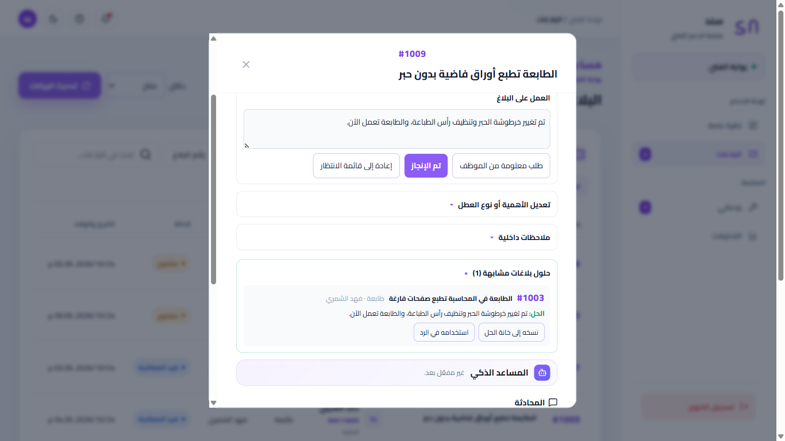
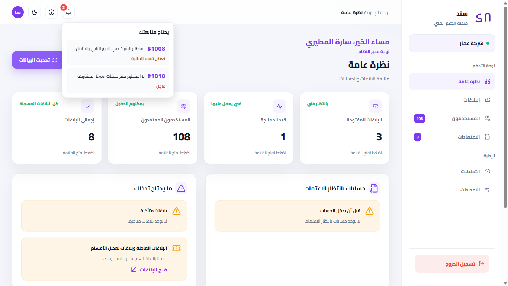
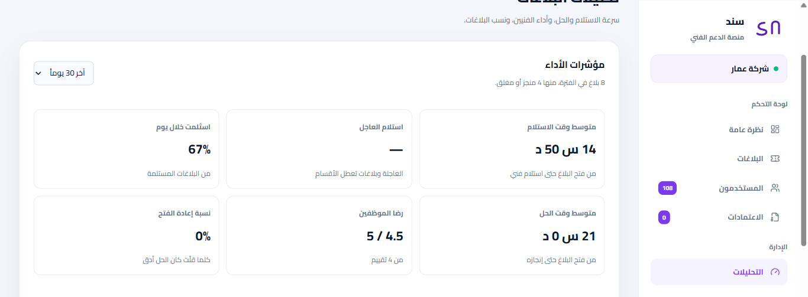
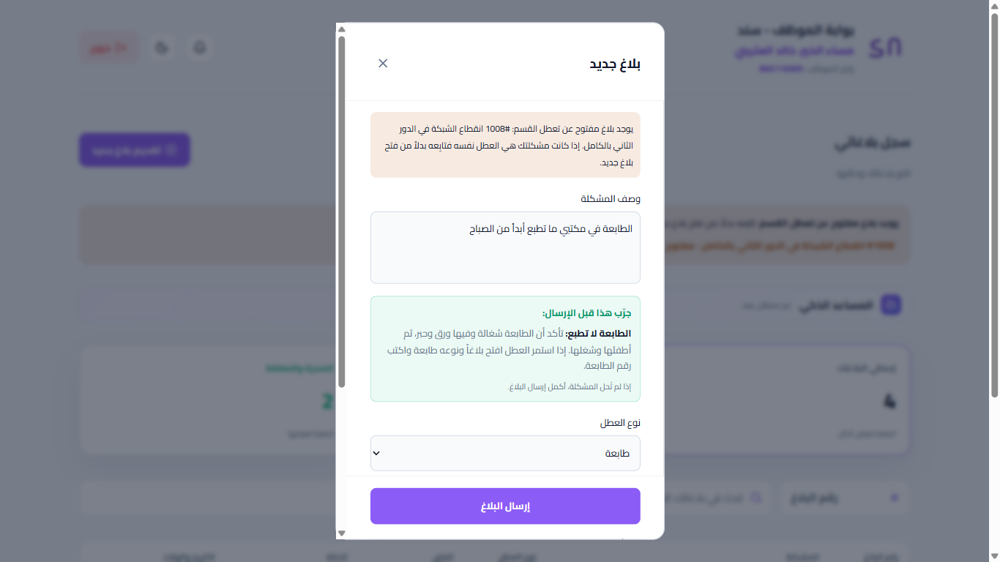
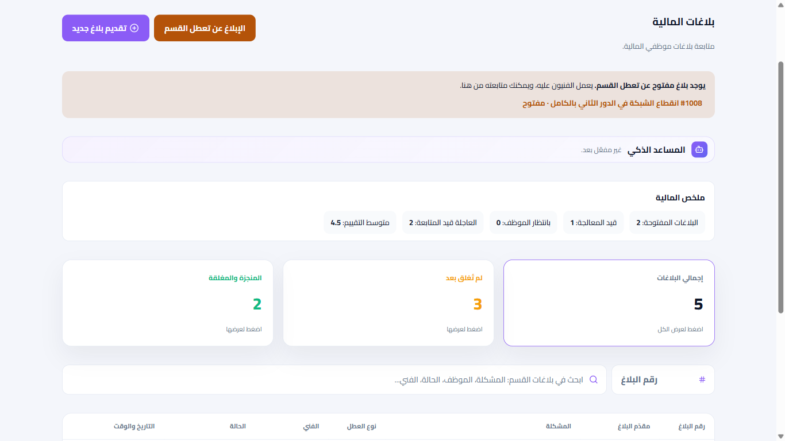
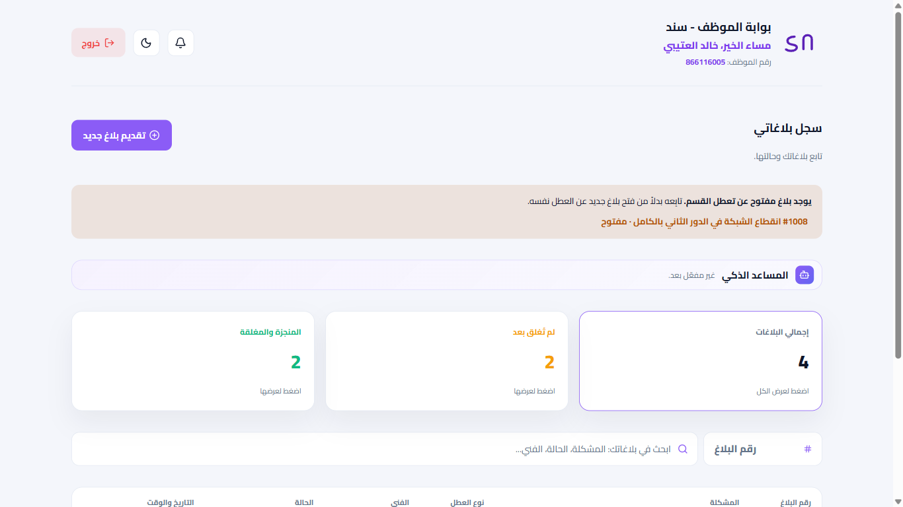
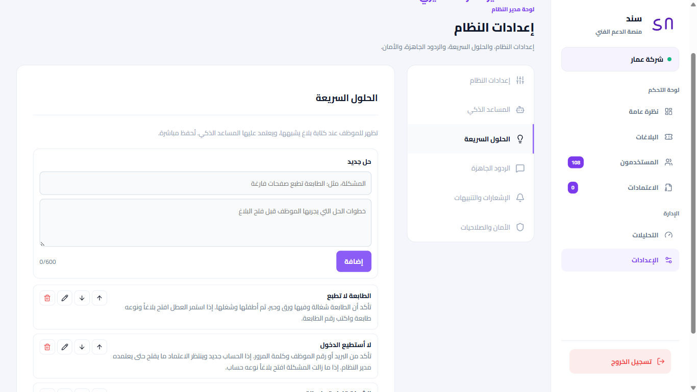

# Ammar Graduation Project — Sanad (سند)

**An AI-powered IT helpdesk platform for organizations, built in Arabic (RTL).**

Employees report technical issues, technicians resolve them through a clear workflow, department heads follow their teams, and administrators get real performance metrics. An AI assistant suggests solutions before a ticket is even opened.

**Live demo:** [sanad-lyart-seven.vercel.app](https://sanad-lyart-seven.vercel.app)

> منصة «سند» لإدارة بلاغات الدعم الفني داخل الجهات، بواجهة عربية كاملة ومساعد ذكي يقترح الحلول قبل فتح البلاغ.
> مشروع تخرج: عمار عابد الفهمي.



---

## Highlights

- **Four roles with real permissions:** employee, department head, technician, and administrator (with granular admin permissions and a protected owner account).
- **Complete ticket lifecycle:** open → in progress → waiting for employee → resolved → closed, with auto-close after 3 days, reopening within 7 days, cancellation rules, and a full audit trail for every change.
- **AI assistant (Anthropic Claude):** gives employees safe self-help steps and technicians deeper diagnostic steps. It learns from the organization's quick solutions and from fixes technicians wrote on past tickets.
- **Arabic text matching:** a custom similarity algorithm (Arabic normalization, stop words, light stemming) shows matching solutions while the employee types, and shows technicians how similar tickets were solved before.
- **Performance metrics:** average time to claim, time to resolve, share claimed within a day, satisfaction rating, reopen rate, and a per-technician table — all computed from the real ticket history.
- **Real-time updates and desktop notifications** for urgent tickets, assignments, and employee replies.
- **Department outage reports:** a department head can report that the whole department is down; it becomes urgent automatically and is visible to the whole department.

## Security

Business rules are enforced inside the database, so they cannot be bypassed by calling the API directly.

- Row Level Security on every table; anonymous visitors have no access to any table or function.
- Database triggers guard every ticket transition, profile change, and role assignment.
- Passwords are hashed by Supabase Auth; no plain-text copy exists anywhere.
- Forced password change on first login, enforced by both the UI and the database.
- Login lockout after 5 failed attempts (and per-network limits), stored server-side.
- A database-level owner flag that only the server can set.
- Attachment validation (images and PDF, 5 MB, 3 per ticket) with short-lived signed download links.
- HTTP security headers (HSTS, frame protection, content-type sniffing protection).

During development I audited the system and fixed 8 security issues, including a disabled RLS policy on the accounts table, a legacy trigger that could overwrite login passwords, and a role-escalation path.

## Tech stack

| Layer | Technology |
|---|---|
| Frontend & server | Next.js 16 (App Router), React 19, TypeScript |
| Database & auth | Supabase — PostgreSQL, Row Level Security, triggers, Auth, Realtime, Storage |
| AI | Anthropic Claude API |
| Styling | Tailwind CSS 4 + custom RTL styles, light and dark modes |
| Hosting | Vercel (HTTPS) |

## Screenshots

| Admin overview & alerts | Performance metrics |
|---|---|
|  |  |

| New ticket with suggested solution | Department head |
|---|---|
|  |  |

| Employee portal | Quick solutions management |
|---|---|
|  |  |

## Project structure

```
app/                 Pages (admin, technician, employee, login) and API routes
components/          Shared UI: ticket tools, conversation, AI assistant, performance panel
lib/                 Workflow rules, Arabic text matching, auth helpers, notifications
supabase/migrations  Database schema, security policies, and triggers (SQL)
```

## Running locally

1. Install dependencies: `npm install`
2. Create `.env.local` with:
   ```
   NEXT_PUBLIC_SUPABASE_URL=
   NEXT_PUBLIC_SUPABASE_ANON_KEY=
   SUPABASE_SERVICE_ROLE_KEY=
   ANTHROPIC_API_KEY=        # optional, enables the AI assistant
   ```
3. Apply the SQL files in `supabase/migrations` to your Supabase project, in date order.
4. Start the app: `npm run dev`, then open http://localhost:3000

## Testing

- 113 automated checks covering the ticket workflow, permissions, and privacy rules against a live database.
- Security tests for owner protection, login lockout, and data access.
- End-to-end browser checks on desktop and mobile, light and dark modes, plus checks on the deployed site.

## Author

**Ammar Abed Alfahmi** — Graduation Project, 2026
